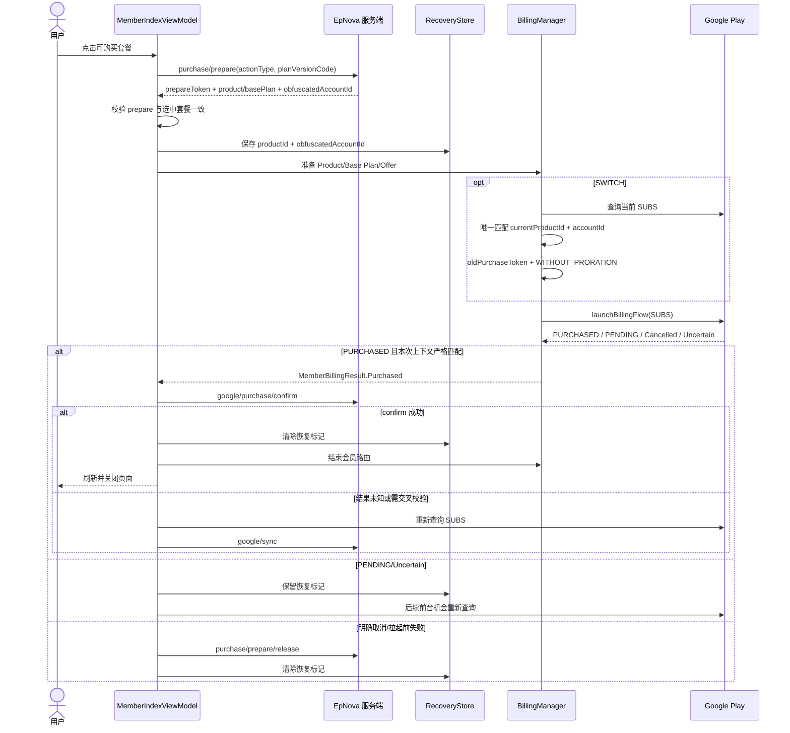

# Google Play 会员订阅流程

## 目标与范围

本文描述 Android 会员页从套餐展示、购买资格、服务端 `prepare`、Google `SUBS` 新购/切换、`confirm`、异常 `sync` 到恢复收敛的完整流程；不包含金币和算力 `INAPP`，其流程见 [Google Play 一次性商品支付流程](google-play-one-time-purchase-flow.md)。会员完成条件是服务端 `confirm` 或恢复用 `sync` 明确成功，Google 返回 `PURCHASED` 只是商店事实，不能直接修改本地会员状态或展示到账成功。

## 业务入口与出口

### 用户入口

| 场景 | 入口 | 入口参数/判断 |
| --- | --- | --- |
| 我的页会员卡片或按钮 | `MineFragment` → `MemberIndexActivity.start()` | 均做登录拦截；卡片容器还会在 `action=NONE` 时拒绝进入 |
| 算力不足引导会员 | `PointInsufficientGuideData.GUIDE_TYPE_MEMBER` → `MemberIndexActivity.start(entryScene)` | 传入创作或余额不足来源，用于曝光归因 |
| 支付按钮 | `btn_member_subscribe` → `MemberIndexViewModel.startMemberSubscription()` | Activity 只转发事件，资格与状态均由 ViewModel 判断 |

`MineViewModel` 通过 `POST trade/member/card/current` 获取会员入口卡片；会员页自身通过 `POST trade/member/plan/list` 获取真实页面模式和可操作套餐。

### 最终出口

| 出口 | 页面行为 | 持久恢复标记 | Billing 路由 |
| --- | --- | --- | --- |
| 正常 `confirm` 成功 | 刷新余额、用户信息，提示成功并关闭会员页 | 清除 | `finishMemberBillingFlow()` |
| 恢复 `sync` 全部成功 | 有完整页面上下文时走同一成功出口；否则刷新套餐与余额 | 清除 | 结束 |
| 用户明确取消/拉起前明确失败 | 尽力调用 `prepare/release`，展示取消或失败 | 清除 | release 收敛后结束 |
| `PENDING`、查询失败、网络未知、300185 | 页面保持 busy，不允许重复购买 | 保留 | 保留/恢复目标商品路由 |
| 稳定业务终态错误 | 刷新套餐，当前页面阻止再次购买 | 清除 | 结束 |
| 有界查询确认没有匹配购买 | 刷新服务端页面状态，不构造 release | 清除 | 结束 |

当前成功提示按目标套餐周期映射：`WEEK` 显示会员已激活，`MONTH` 显示升级已预约，其他周期使用通用支付成功提示。

## 组件职责与状态归属

| 组件 | 职责 |
| --- | --- |
| `MemberIndexActivity` | 初始化页面、转发点击、打开协议，不持有支付业务状态 |
| `MemberIndexViewModel` | 套餐资格、完整 prepare 上下文、Billing 结果、confirm/release、同进程恢复 |
| `BillingManager` | 严格解析 Google Product/Base Plan/Offer、构造切换参数、拉起 `SUBS`、输出商店事实 |
| `MemberSubscriptionRecoveryStore` | 保存当前账号的一条最小恢复信号，不保存交易凭证 |
| `MemberSubscriptionRecoveryManager` | 页面上下文丢失后的进程级 SUBS 查询与幂等 sync |
| 服务端 | 决定套餐动作、建立 prepare 锁、校验官方凭证、发放/切换会员权益并提供恢复同步 |

页面内 `ActiveMemberPurchaseContext` 保存 `purchasePrepareToken`、目标商品/Base Plan、账号混淆标识和流程标志，只存在于 ViewModel 内存。进程重启后只保留 MMKV 中的 `ownerUserId + productId + obfuscatedAccountId`，不持久化 `purchaseToken`、`purchasePrepareToken`。

## 套餐加载与购买资格

服务端套餐字段及客户端含义：

| 字段 | 用途 |
| --- | --- |
| `pageMode` | 页面级 `PURCHASE` 或 `SWITCH` 模式 |
| `planVersionCode` | 不可变套餐版本，传给 `purchase/prepare` |
| `productId` / `basePlanId` / `offerId` | Google 商品、Base Plan 和首选 Offer 的严格匹配键 |
| `action` | 单个套餐的资格事实；只有 `PURCHASE`、`SWITCH` 可点击 |
| `CURRENT` | SWITCH 时定位旧订阅商品；必须唯一 |
| `PENDING_SWITCH` / `UNAVAILABLE` | 仅展示，不允许客户端自行解释为可购买 |

订阅按钮同时要求：套餐接口成功、必填字段完整、Google Offer 已解析、SWITCH 当前商品唯一、无进行中支付/恢复标记、Billing 全局路由空闲。

Offer 规则只有以下四种：

1. `basePlanId` 必须完全一致，禁止回退到其他 Base Plan。
2. 后端没有 `offerId` 时，只能选择同 Base Plan 下 `offerId == null` 的标准价格。
3. 后端首选 Offer 对当前 Google 账号可用时使用它。
4. 首选 Offer 因资格不可用时，只能回退到同 Base Plan 的标准价格，禁止选择其他营销 Offer。

展示价格和购买前校验复用同一个解析器，防止页面展示价与实际扣款 Offer 不一致。

## 正常购买与切换时序

### 1. 服务端 prepare

请求 `POST trade/member/subscription/purchase/prepare`：

| 字段 | 值 |
| --- | --- |
| `actionType` | 选中套餐的 `PURCHASE` 或 `SWITCH` |
| `planVersionCode` | 点击时套餐快照中的不可变版本编码 |
| `appsFlyerId` | 当前归因标识 |

成功响应必须包含 `purchasePrepareToken`、`productId`、`basePlanId`、`obfuscatedAccountId`；`productId + basePlanId` 还必须与点击时套餐一致。字段缺失或漂移时，若有 prepare token 就调用 release，没有 token 则直接失败，绝不拉起 Google。

prepare 成功后立即保存恢复信号，再查询商店参数。无法建立当前账号恢复标记时，客户端释放 prepare 并停止，避免扣款后无法安全恢复。

### 2. PURCHASE 与 SWITCH 的商店参数

- `PURCHASE`：`googleReplacementMode` 必须为空，只传目标商品和 Offer。
- `SWITCH`：必须有唯一 `CURRENT.productId`，后端必须返回替换模式；当前只支持 `WITHOUT_PRORATION`。
- SWITCH 会查询 Google 当前 `SUBS`，只接受同时匹配 `currentProductId` 和后端 `obfuscatedAccountId` 的购买。
- 匹配到 `PENDING` 或未知状态时保留 prepare，等待下次前台查询；没有唯一一条 `PURCHASED` 时不猜测 old token。
- 唯一匹配成功后，用其 `purchaseToken` 构造 `SubscriptionUpdateParams.oldPurchaseToken` 和 `WITHOUT_PRORATION`。

### 3. Billing 回调与 confirm

`BillingManager` 先按当前 `activeMemberProductId` 路由，ViewModel 再按 `productId + obfuscatedAccountId` 校验归属。`memberBillingResultFlow` 不重放历史事件，因此 ViewModel 在允许点击前已经持续收集，不能像一次性商品那样 `take(1)`。

匹配的 `PURCHASED` 首次到达时调用 `POST trade/member/subscription/google/purchase/confirm`：

| 字段 | 正常 confirm 来源 |
| --- | --- |
| `purchaseToken` | Google 回调 |
| `productId` | prepare 响应 |
| `purchasePrepareToken` | prepare 响应 |
| `basePlanId` | prepare 响应 |
| `appsFlyerId` | 当前归因标识 |

同一上下文只尝试一次 confirm，防止 Google 重复回调造成并发提交。confirm 成功才清标记、结束路由、刷新 `Global.refreshCoinsAndPoints()` 和 `Global.refreshUserInfo()`。

## 取消、失败与 prepare release

`POST trade/member/subscription/purchase/prepare/release` 只传 `purchasePrepareToken + appsFlyerId`。允许 release 的前提是客户端能够确认没有官方交易：

- 用户明确取消，且此前从未观察到 `PURCHASED`/`PENDING`；
- Product、Base Plan、Offer、SWITCH 当前购买等拉起前校验明确失败；
- Billing 连接/启动明确失败，且没有任何官方购买事实。

release 请求本身失败也会结束本地流程；服务端 prepare 锁依赖超时机制兜底。以下情况禁止 release：`PENDING`、`ITEM_ALREADY_OWNED`、超时/断线/网络错误、回调缺失、查询结果未知，以及曾经观察到任何匹配官方购买。

若 release 已发出后迟到的 `PURCHASED`/`PENDING` 到达，客户端会取消尚未完成的 release 任务语义，恢复到 confirm/sync 路径；官方购买事实优先于先到的取消/失败结果。

## 同进程异常恢复

需要恢复的触发包括：Billing 返回 `Uncertain`、confirm 结果未知或 300185、支付页返回但 1.5 秒内没有回调、SWITCH 准备遇到 PENDING/未知、页面重建发现恢复标记。

恢复查询严格使用 `BillingClient.ProductType.SUBS`：

1. 先重建目标 `productId` 的会员回调路由；若一次性商品或其他会员流程占用则保留标记等待。
2. Billing 连接/查询失败最多自动尝试两次，每次间隔 1.5 秒；仍失败后等待下次前台事件。
3. 查询成功后仅保留同时匹配 `productId + obfuscatedAccountId` 的购买，并按 token 去重。
4. `PENDING` 或 `UNSPECIFIED` 保留 busy、标记和路由，不 confirm、不 sync、不 release。
5. 匹配 `PURCHASED` 时逐笔调用 `google/sync`；不使用 `firstOrNull` 猜 token。
6. 支付页刚返回的第一次空结果会等待 1.5 秒再查一次；仍为空则清本地标记、结束路由并刷新 `plan/list`，但不拿旧 prepare token 调 release。

恢复 `sync` 的 `basePlanId` 始终为空，因为 `queryPurchasesAsync` 不能可靠说明同一 Product 内实际 Base Plan；由服务端通过 Google 官方订阅状态判定。同进程仍有上下文时可携带原 `purchasePrepareToken`，进程重启后该字段为空。

## 进程重启恢复

`MemberSubscriptionRecoveryManager` 由 `MainActivity` 初始化和后续 `onResume` 触发；进入会员页时，ViewModel 也会接管未被进程恢复器占用的标记。主页面总是先完成一次性 `INAPP` 恢复，再启动会员 `SUBS` 恢复，避免争用 Billing 连接。

进程恢复器使用 Application 级有限任务：查询/路由失败最多两次、间隔 1.5 秒；两次成功查询都无匹配交易时结束本地标记并刷新页面，丢失的 prepare 锁由服务端超时释放。查询到多笔匹配的 `PURCHASED` 时逐笔调用：

`POST trade/member/subscription/google/sync`

请求包含真实 `purchaseToken`、标记中的 `productId`、`appsFlyerId`，并令 `purchasePrepareToken=null`、`basePlanId=null`。token 只存在于本次调用栈，不写入 MMKV、日志或事件。

## 服务端错误分流

| 错误类别 | 客户端行为 |
| --- | --- |
| 网络异常、非 `ApiException`、未登记业务 code | 视为结果未知；confirm 后转查询/sync，sync 后保留标记等待下次前台 |
| `300185` 官方凭证交叉校验失败 | 保留标记，重新查询 Google 后再决定 sync |
| `300181`、`300182`、`300184`、`300186`、`300189`、`300191` | 当前实现认定为稳定业务终态：不再自动 sync，清标记并刷新服务端页面；可见会员页同时阻止本页再次购买 |

仓库仅维护上述分组，没有保存每个稳定 code 的逐项业务文案；若服务端调整 code 语义，必须同步修改两个恢复实现和本文。

## 接口总表

| 阶段 | 方法与路径 | 请求/响应重点 |
| --- | --- | --- |
| 我的页会员卡 | `POST trade/member/card/current` | 响应 `display`、`action`、卡片文案 |
| 会员套餐 | `POST trade/member/plan/list` | 响应 `pageMode`、套餐 action、Google Product/Base Plan/Offer |
| 建立购买准备 | `POST trade/member/subscription/purchase/prepare` | 请求 action + plan version；响应 prepare token 与 Google 参数 |
| 明确未成交后释放 | `POST trade/member/subscription/purchase/prepare/release` | 请求 prepare token；响应 `released`，但本地不依赖其成功才能结束 |
| 正常购买确认 | `POST trade/member/subscription/google/purchase/confirm` | 携带完整 prepare 上下文和 Google token |
| 异常/重启同步 | `POST trade/member/subscription/google/sync` | Google token 必填；prepare token 可空，Base Plan 在恢复中为空 |

## 安全、并发与客户端边界

- `purchaseToken` 和 `purchasePrepareToken` 禁止输出到普通日志；相关上下文使用普通 class，避免 `data class.toString()` 泄漏。
- 恢复标记绑定当前 EpNova 用户；切换账号不会把旧账号购买提交给新账号。
- 一次只允许一个 Google 支付路由；`orderId`、`activeMemberProductId`、`isPurchasing` 和页面 busy 状态共同防止串单。
- 客户端不调用 `consumeAsync()` 或 `acknowledgePurchase()`；会员权益及所需商店确认以后端 `confirm/sync` 契约为准。
- 页面销毁会取消页面 Job，但不会删除 MMKV 恢复标记；进程级恢复可在没有会员页时收敛。

## 已知风险

- 清除应用数据或卸载会丢失恢复标记，客户端无法再按 EpNova 账号严格筛选 Google 购买，需依赖服务端 RTDN/定时对账。
- 成功提示当前由 `periodUnit` 而非 `actionType` 决定；若未来支持更多周期或“月卡新购/周卡切换”等组合，需要重新校验提示语义。
- 稳定业务错误 code 的逐项含义不在仓库内，客户端只能维护分组；服务端契约变更若未同步会影响是否继续恢复。

## 实现对齐

| 关注点 | 稳定代码锚点 | 状态 |
| --- | --- | --- |
| 页面编排 | [`MemberIndexViewModel.kt`](../../../app/src/main/java/com/kuaigeglobal/epnova/feature/member/MemberIndexViewModel.kt) | complete |
| Activity 入口 | [`MemberIndexActivity.kt`](../../../app/src/main/java/com/kuaigeglobal/epnova/feature/member/MemberIndexActivity.kt) | complete |
| Billing 与 Offer/SWITCH | [`BillingManager.kt`](../../../app/src/main/java/com/kuaigeglobal/epnova/core/google/billing/BillingManager.kt) | complete |
| 恢复标记 | [`MemberSubscriptionRecoveryStore.kt`](../../../app/src/main/java/com/kuaigeglobal/epnova/core/google/billing/MemberSubscriptionRecoveryStore.kt) | complete |
| 进程级恢复 | [`MemberSubscriptionRecoveryManager.kt`](../../../app/src/main/java/com/kuaigeglobal/epnova/core/google/billing/MemberSubscriptionRecoveryManager.kt) | complete |
| 请求与响应模型 | [`MemberSubscriptionBody.kt`](../../../app/src/main/java/com/kuaigeglobal/epnova/core/network/apis/request/MemberSubscriptionBody.kt)、[`MemberSubscriptionData.kt`](../../../app/src/main/java/com/kuaigeglobal/epnova/core/network/apis/response/MemberSubscriptionData.kt) | complete |

## 验收与验证

- plan/list 与 Google Offer 任一关键字段不一致时按钮不可用，且不会创建错误扣款。
- prepare 成功后、拉起 Google 前已有当前账号恢复标记；无法保存标记时先 release。
- `PURCHASED` 只进入 confirm/sync，不直接发放本地会员状态，也不 release。
- `PENDING`、未知 Billing 结果、confirm/sync 网络失败和 300185 均保留标记并阻止重复购买。
- 正常回调优先 confirm；只有成功查询 SUBS 得到的恢复购买才能进入 sync。
- 用户取消或拉起前明确失败才 release；进程重启后绝不构造空 prepare token 调 release。
- confirm/sync 成功后清标记、结束会员路由并从服务端重新读取会员与余额状态。
