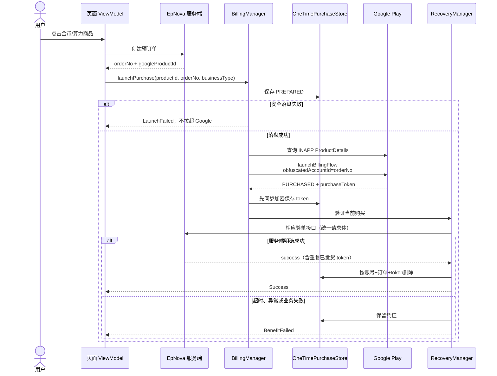
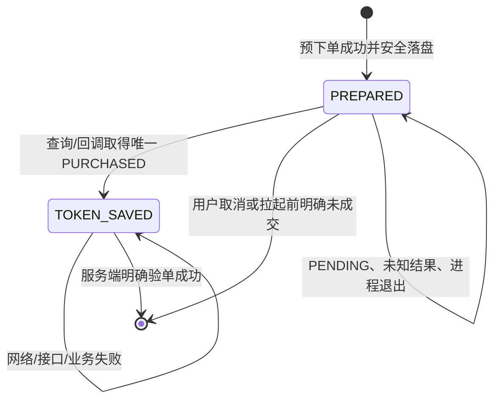

# Google Play 一次性商品支付流程

## 目标与范围

本文描述 Android 端 Google Play `INAPP` 一次性商品的完整业务闭环，包括金币（Coins）和算力（Credits/Points）的页面入口、预下单、拉起支付、凭证安全落盘、服务端验单、异常恢复和最终出口。

不包含支付宝、微信支付和 Google `SUBS` 会员订阅；会员链路见 [Google Play 会员订阅流程](google-play-member-subscription-flow.md)。

完成条件只有一个：服务端验单接口明确返回成功。Google 返回 `PURCHASED` 只说明商店交易成立，不代表金币或算力已经发放。

## 业务入口与出口

### 用户入口

| 场景 | 入口组件 | 进入的购买编排 |
| --- | --- | --- |
| 我的页金币、算力卡片 | `MineFragment` → `CoinBalanceActivity` / `CreditsBalanceActivity` | `MyBalanceViewModel` |
| App Scheme | `epnovascheme://toStoreCoins` / `epnovascheme://toStoreCredits` → `AppRouter` | `MyBalanceViewModel` |
| 余额不足 | `PowerRechargeDialog` | `MyBalanceViewModel`，由 `TAB_COINS` / `TAB_CREDITS` 区分业务 |
| 金币首充 | `FirstRechargeDialog` | `FirstRechargeViewModel` |
| 算力首充 | `FirstRechargeCreditsDialog` | `FirstRechargeCreditsViewModel` |

商城中点击商品即选择并启动购买；首充弹窗由“立即支付”按钮启动。所有入口最终都先调用 `CoinRepository` 创建服务端订单，再进入同一个 `BillingManager.launchPurchase(...)`。

### 业务出口

| 出口 | 对页面的结果 | 本地记录 | 后续行为 |
| --- | --- | --- | --- |
| 验单成功 | `PurchaseResult.Success` | 删除对应凭证 | 刷新金币/算力；弹窗入口关闭并回调成功，商城重新加载配置 |
| Google 状态待定或调用结果未知 | `PurchaseResult.Pending` | 保留 | 当前页面不宣告成功；等待生命周期恢复扫描 |
| Google 已付款但本次验单未成功 | `Failed.BenefitFailed` | 保留 token | 页面展示支付异常提示；后台或下次入口继续幂等验单 |
| 用户明确取消 | `PurchaseResult.Cancelled` | 只删除无 token 的 `PREPARED` | 展示取消提示，结束当前页面支付等待 |
| 拉起前明确失败或商店明确未成交 | `Failed.LaunchFailed` / `Failed.PaymentFailed` | 只删除无 token 的 `PREPARED` | 结束本次页面流程，可重新购买 |

恢复任务成功时可能已经没有原页面订阅者，因此它不伪造旧页面的 `PurchaseResult.Success`，而是刷新全局余额并发出不携带敏感字段的 `settled` 信号。

## 组件职责与边界

| 组件 | 职责 |
| --- | --- |
| `MyBalanceViewModel` / 两个首充 ViewModel | 选择业务类型、创建订单、先监听结果再拉起支付、处理页面出口 |
| `CoinRepository` | 调用金币或算力预下单接口 |
| `BillingManager` | 互斥支付、查询 `INAPP` 商品、拉起 Google 页面、接收唯一 Billing 回调并路由 |
| `OneTimePurchaseStore` | 在付款前保存订单上下文，在网络前保存 `purchaseToken`，加密持久化未完成记录 |
| `OneTimePurchaseRecoveryManager` | 应用级串行扫描、查询 Google 当前购买、按业务类型调用相同验单接口 |
| 服务端 | 校验订单与 Google 凭证、幂等发货、负责 consume，并用成功响应通知客户端清理凭证 |

一次性商品与会员订阅共用一个 `BillingClient` 和 `PurchasesUpdatedListener`，但不能共用服务端链路。`orderId` 标识当前 `INAPP` 路由，`activeMemberProductId` 标识会员路由；任一链路未收敛时都不能覆盖另一条路由。

## 正常购买时序

### 1. 查询商品与创建订单

商城页面先请求商品配置，并用 Google `ProductDetails` 补充本地化价格：

| 业务 | 配置接口 | 预下单接口 | 预下单关键参数 |
| --- | --- | --- | --- |
| 金币 | `POST trade/coins/config/list` | `POST trade/pay/google/coin/preOrder` | `goodsCode=coinsConfigCode`、`goodsType=1`、`mobileType=1`、`appsFlyerId` |
| 算力 | `POST trade/point/config/list` | `POST trade/pay/google/createPreOrder` | `goodsCode=pointConfigCode`、`goodsType=1`、`mobileType=1`、`appsFlyerId` |

预下单返回 `OrderNoData(orderNo, googleProductId)`。支付优先使用响应中的 `googleProductId`；为空时才回退到当前商品配置的 `googleProductId`。`orderNo` 或最终 `productId` 为空会在 Billing 入口失败，不会拉起 Google。

### 2. 付款前建立可恢复上下文

`launchPurchase` 在连接 Billing 服务之前调用 `savePrepared`，保存：

- 当前 EpNova 账号归属：优先 `userId`，缺失时回退 `userUid`；
- `businessType`：`COINS` 或 `CREDITS`，用于恢复后选择正确验单接口；
- `orderNo`、`productId`、`createdAt`；
- `purchaseToken=null`，此时状态为 `PREPARED`。

只有记录可靠写入后才允许支付。存储读取、加密或原子写入失败时直接返回 `LaunchFailed`，避免出现“已经扣款但客户端没有恢复线索”。

### 3. 拉起 Google Play

`BillingManager` 查询类型严格为 `BillingClient.ProductType.INAPP` 的商品，并构造：

- `obfuscatedAccountId = orderNo`：Google 回调与内部订单的主要匹配键；
- `obfuscatedProfileId = 当前 userId`；
- `setIsOfferPersonalized(true)`。

缓存商品也必须再次校验 `productType == INAPP`。进程内通过 `isPurchasing`、`orderId` 和会员路由共同阻止并发串单。

### 4. 先保存凭证，再发网络请求

全局 Billing 回调的第一步是 `OneTimePurchaseStore.capturePurchased(purchases)`，发生在业务路由和任何验单请求之前。只有同时满足以下条件的购买才会写入：

- `purchaseState == PURCHASED`，且 `purchaseToken` 非空；
- Google `obfuscatedAccountId` 与本地 `orderNo` 完全一致；
- 本地 `productId` 存在于 `Purchase.products`；
- 一条本地订单只唯一匹配一条 token，已有 token 不允许被另一 token 覆盖。

即使用户在 Google 页面期间切换登录态，捕获仍可按订单和商品找到原记录；真正验单只处理当前 EpNova 账号所属记录。

### 5. 调用验单接口

金币和算力使用完全相同的 `VerifyPurchasedBody`：

| 字段 | 来源 | 说明 |
| --- | --- | --- |
| `verifyData` | Google `purchaseToken` | 敏感凭证，不得进入日志或普通存储 |
| `orderNo` | 预下单响应 | EpNova 内部订单号 |
| `googleProductId` | 预下单/商品配置 | 必须与捕获购买严格匹配 |
| `appsFlyerId` | `Config` | 归因标识；登录鉴权由公共请求体/网络层携带 |

接口按本地 `businessType` 路由：

- 金币：`POST trade/pay/google/coin/verifyReceipt`
- 算力：`POST trade/pay/google/payCallBack`

服务端保证：重复提交已经成功发货的 token 仍返回成功。因此客户端可在超时、进程退出或“服务端成功但响应丢失”后安全重试。

## 本地状态与删除规则

记录使用 `AtomicFile` 保存于 `noBackupFilesDir`，正文由 Android Keystore 密钥通过 `AES/GCM/NoPadding` 加密。订单号、账号标识和 token 均不得写入普通 MMKV、日志或 Crashlytics message。

删除约束：

- `removePreparedForCurrentUser(orderNo)` 只能删除当前账号且 `purchaseToken == null` 的记录；
- token 已保存后，唯一删除入口是服务端成功后的 `removeAfterServerSuccess(record)`；
- 删除时再次按账号、订单号和 token 三重匹配；删除写盘失败则继续保留，后续仍可幂等验单；
- App 关闭、页面销毁、网络超时、异常、HTTP/业务失败、鉴权失败都不能删除 token。

## Google 回调分流

| Google 事实/响应 | 客户端处理 | 是否保留记录 |
| --- | --- | --- |
| 匹配订单的 `PURCHASED` | 先保存 token，再立即验单 | 验单成功才删 |
| `OK` 但为 `PENDING`、`UNSPECIFIED` 或没有当前订单 | 返回 `Pending` | 是 |
| `USER_CANCELED` | 结束路由，只清理无 token 的 `PREPARED` | token 记录始终保留 |
| `ITEM_ALREADY_OWNED`、超时、断连、服务不可用、网络错误、通用错误 | 视为结果未知，安排恢复查询 | 是 |
| 商品不可用、配置错误等其他明确失败 | 返回支付失败，只清理无 token 的记录 | token 记录始终保留 |

会员路由活跃时若收到迟到的 `INAPP` 成功回调，监听器仍先捕获其凭证并启动一次性商品恢复，但不会把它误报成会员结果。

## 恢复入口与算法

| 触发点 | 实现位置 | 目的 |
| --- | --- | --- |
| App 主进程完成 API 安全初始化 | `App.sdkConfigTask` | 冷启动恢复 |
| App 从后台回到前台 | `AppStatusTracker.onActivityStarted` | 捕获后台期间完成的购买 |
| 主页面初始化、主页面再次 `onResume` | `MainActivity` | 与会员恢复串行，先处理 `INAPP` |
| 进入金币/算力商城或充值弹窗 | `MyBalanceViewModel.init` | 充值入口主动扫描 |
| 进入两类首充弹窗 | 两个首充 ViewModel 的 `init` | 首充入口主动扫描 |
| 不确定 Billing 结果或捕获到迟到凭证 | `BillingManager` | 不等待下一次生命周期事件 |

恢复器使用 Application 级 `SupervisorJob`、`Mutex` 和重复启动保护，同一进程内串行执行一轮有限扫描：

1. 只读取当前 EpNova 账号的记录；没有记录立即结束。
2. 对已含 token 的记录直接调用验单接口，不先查询 Google。这样即使服务端已经 consume、Google 查询不再返回该商品，仍能依赖服务端幂等结果完成本地清理。
3. 只有存在 `PREPARED` 时才查询 Google 当前 `INAPP` 购买；连接正在建立时最多等待 5 秒，查询失败返回“未知”而不是空购买。
4. 将查询到的 `PURCHASED` 按 `orderNo + productId` 捕获并加密落盘。
5. 对本轮新增 token 再调用同一验单接口；单轮内用 token 集合避免重复提交。
6. 任一订单成功后刷新 `Global.refreshCoinsAndPoints()`；未成功的记录留待下次触发。

恢复不是轮询：一轮失败后等待下次启动、前台化、充值入口或 Billing 事件。页面被关闭不影响已启动的应用级验单；进程被杀后依靠加密文件继续。

## 关键约束与已知风险

- 服务端负责 consume；客户端不调用 `consumeAsync()`，也不以 `acknowledgePurchase()` 作为兜底。
- `PurchaseResult.Pending` 会结束页面当前的 `take(1)` 收集；后续恢复成功主要通过全局余额刷新体现，而不是向已消失页面重放成功事件。
- 当前不会按时间自动删除孤立 `PREPARED`。这会增加后续入口的查询次数，但避免因客户端猜测订单过期而漏单。
- 恢复必须依赖付款前保存的 `orderNo + productId + businessType`。旧版本遗留、清除数据或卸载后仅存在于 Google 的购买无法由客户端安全判断金币/算力接口，应由服务端对账兜底。
- 切换 EpNova 账号后不会把原账号记录提交给新账号；只有重新登录原账号才会继续扫描。

## 实现对齐

| 关注点 | 稳定代码锚点 | 状态 |
| --- | --- | --- |
| 页面购买入口 | [`MyBalanceViewModel.kt`](../../../app/src/main/java/com/kuaigeglobal/epnova/feature/recharge/MyBalanceViewModel.kt) | complete |
| 首充入口 | [`FirstRechargeViewModel.kt`](../../../app/src/main/java/com/kuaigeglobal/epnova/feature/splash/newer/FirstRechargeViewModel.kt)、[`FirstRechargeCreditsViewModel.kt`](../../../app/src/main/java/com/kuaigeglobal/epnova/feature/splash/newer/FirstRechargeCreditsViewModel.kt) | complete |
| Billing 启动与回调路由 | [`BillingManager.kt`](../../../app/src/main/java/com/kuaigeglobal/epnova/core/google/billing/BillingManager.kt) | complete |
| 加密记录 | [`OneTimePurchaseStore.kt`](../../../app/src/main/java/com/kuaigeglobal/epnova/core/google/billing/OneTimePurchaseStore.kt) | complete |
| 应用级恢复 | [`OneTimePurchaseRecoveryManager.kt`](../../../app/src/main/java/com/kuaigeglobal/epnova/core/google/billing/OneTimePurchaseRecoveryManager.kt) | complete |
| 接口声明与模型 | [`ApiService.kt`](../../../app/src/main/java/com/kuaigeglobal/epnova/core/network/apis/ApiService.kt)、[`VerifyPurchasedBody.kt`](../../../app/src/main/java/com/kuaigeglobal/epnova/core/network/apis/request/VerifyPurchasedBody.kt) | complete |

## 验收与验证

- 预下单成功但安全存储失败时不得出现 Google 支付页。
- `PURCHASED` 回调进入任何网络代码前，本地必须已有对应 token。
- 断网、超时、接口失败或杀进程后记录仍存在；恢复触发后使用原接口、原请求体重试。
- 重复提交已发货 token 返回成功后，本地记录被清理且余额刷新。
- 用户取消只能清理无 token 的记录；任何含 token 记录都不能由客户端失败分支删除。
- 一次性商品全链路不调用客户端 consume 或 acknowledge。
