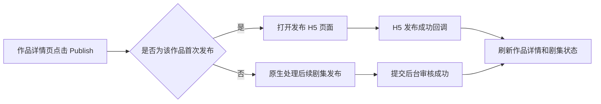
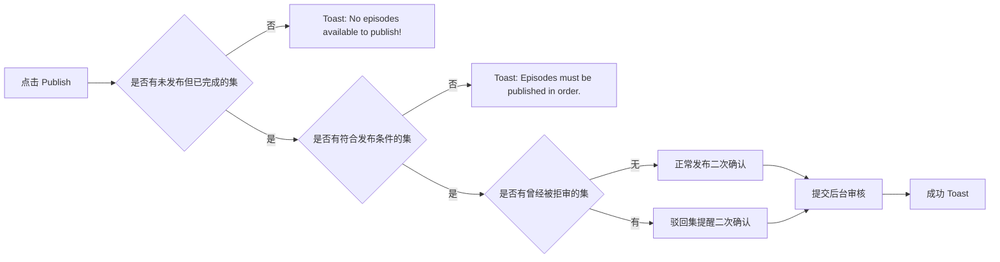

# 作品发布流程说明

整理时间：2026-05-21  
来源：MasterGo 发布流程截图局部放大图  
范围：作品详情页点击 `Publish` 后的发布判断、H5 交互、原生发布审核提交逻辑。发布 H5 页面本身不由 Android 实现。
关联逻辑文档：[作品发布功能逻辑说明](work-publish-logic.md)

## 1. 流程总览

用户在作品详情页点击底部 `Publish` 后，先判断该作品是否为首次发布：

- 首次发布：进入发布 H5 页面，由 H5 完成协议确认、首批发布集数确认、个人资料填写和提交。首批发布最低门槛是前 15 集全部已合成，实际提交范围按第 1 集起连续已合成集动态计算。
- 非首次发布：Android 原生侧处理后续剧集发布，包括可发布集判断、顺序发布校验、驳回集提醒、二次确认和提交审核。



## 2. 首次发布流程，H5 负责

首次发布指该作品第一次进入发布流程。Android 点击 `Publish` 后打开发布 H5 页面，H5 内部继续处理：

1. 用户在 H5 页面点击 `Publish`。
2. H5 判断是否已完成第 1-15 集。
3. 如果未完成，弹出未完成提示。
4. 如果已完成，判断用户是否勾选发布协议。
5. 如果未勾选协议，弹出默认同意发布协议的确认弹窗。
6. 协议确认后，弹出 `Publish Episodes 1-N?` 二次确认弹窗，`N` 按本次实际连续可提交集数动态展示。
7. 用户确认后，弹出 `Personal Info` 个人资料弹窗。
8. 用户填写 `Legal Name` 和 `Email Address` 后点击 `Submit`。
9. 提交成功后，H5 展示成功 toast，并通知 Android 刷新作品状态。

### 2.1 未完成 1-15 集

触发条件：H5 判断作品未完成第 1-15 集。

弹窗文案：

```text
Please complete episodes 1-15 before publishing.

OK
```

### 2.2 未勾选发布协议

触发条件：已完成 1-15 集，但用户未勾选发布协议。

弹窗文案：

```text
Publishing this drama means you agree to the Distribution Service Agreement.
Do you want to continue?

Cancel / Publish
```

用户点击 `Publish` 后，视为同意协议并继续发布确认流程。

### 2.3 首次发布二次确认

触发条件：已完成前 15 集，且协议确认完成。

弹窗文案：

```text
Publish Episodes 1-N?

These episodes will be submitted for review and made available to viewers once approved.
This action cannot be undone.

Cancel / Publish
```

### 2.4 个人资料填写

触发条件：用户确认发布首批连续可提交剧集。

弹窗文案和字段：

```text
Personal Info

Required to process your publishing application

We'll review your submission within 3-7 business days and notify you by email.

Legal Name*
Your full legal name

Email Address*
email@example.com

Submit

By submitting, you acknowledge our Privacy Policy.
```

提交成功 toast：

```text
You're all set!

Your application has been submitted.
```

## 3. 非首次发布流程，Android 原生负责

非首次发布指该作品已经发布过首批剧集，后续再次点击 `Publish` 时走原生逻辑。



### 3.1 没有可发布剧集

判断条件：没有未发布但已完成的集。

toast 文案：

```text
No episodes available to publish!
```

### 3.2 不满足顺序发布

判断条件：存在未发布且已完成的集，但没有符合发布条件的集，原因是不可跳集发布。

toast 文案：

```text
Episodes must be published in order.
You cannot skip episodes.
```

### 3.3 正常后续发布确认

判断条件：

- 有未发布但已完成的集。
- 满足顺序发布条件。
- 本次发布范围内没有曾经被拒审的集。

弹窗文案示例：

```text
Publish Episodes 17-20?

These episodes will be submitted for review and made available to viewers once approved.
This action cannot be undone.

Cancel / Publish
```

其中 `17-20` 需要根据本次实际可发布的连续剧集范围动态生成。

### 3.4 包含曾经被拒审的剧集

判断条件：

- 有未发布但已完成的集。
- 满足顺序发布条件。
- 本次发布范围内包含曾经被拒审的集。

弹窗文案示例：

```text
Publish Episodes 17-20?

This submission contains rejected episodes.
Please ensure they are revised based on the feedback before resubmitting.

Cancel / Publish
```

用户点击 `Publish` 后，提交后台审核。

### 3.5 后续发布提交成功

提交成功后 toast：

```text
You're all set!

Your application has been submitted.
```

成功后刷新作品详情和剧集列表状态。

## 4. Android 与 H5 交互边界

Android 不实现发布 H5 页面。已确认：Android 只负责判断是否首次发布；首次发布进入 H5 后，发布流程全部由 H5 完成。

Android 侧需要负责：

1. 在作品详情页点击 `Publish` 后，判断该作品是否首次发布。
2. 首次发布时打开发布 H5 页面。
3. 打开 H5 时传入 H5 所需的上下文参数，例如作品 ID、登录 token、语言、客户端类型等。
4. 接收 H5 发布结果通知。
5. H5 发布成功后刷新作品详情、剧集列表和发布状态。
6. 非首次发布时走原生逻辑，不进入 H5。
7. 原生提交审核成功后刷新作品详情、剧集列表和发布状态。

H5 侧需要负责：

1. 首次发布页面 UI 和交互。
2. 判断或通过接口获取前 15 集是否已完成。
3. 协议勾选与默认同意确认。
4. 首批连续可提交剧集发布二次确认。
5. 个人资料填写、校验和提交。
6. 发布成功后的页面行为与 Android 通知方式。

## 5. 建议的状态与字段

具体字段以接口返回为准，Android 侧至少需要能判断以下信息：

| 字段含义 | 用途 |
| --- | --- |
| 作品 ID | 打开 H5、提交后续发布、刷新详情 |
| 是否首次发布 | 决定进入 H5 还是原生后续发布 |
| 剧集序号 | 计算本次发布范围，例如 17-20 |
| 剧集是否完成 | 判断是否存在未发布但已完成的集 |
| 剧集是否已发布/审核中 | 过滤不可重复发布的集 |
| 剧集是否曾经被拒审 | 决定使用正常确认弹窗还是驳回提醒弹窗 |
| 发布顺序状态 | 判断是否允许连续发布，禁止跳集 |

## 6. 实现检查点

- 点击 `Publish` 后必须先判断是否首次发布。
- 首次发布只打开 H5，不在 Android 原生侧实现 H5 页面内的弹窗、表单和协议逻辑。
- H5 发布成功后，Android 必须刷新作品详情和剧集状态，避免页面仍显示旧状态。
- 非首次发布时，先判断是否有未发布但已完成的集，再判断是否满足顺序发布。
- 后续发布二次确认弹窗标题中的剧集范围必须按实际连续可发布范围动态生成。
- 本次发布范围内包含曾经被拒审的剧集时，必须展示驳回提醒文案。
- 所有成功提交审核的分支统一展示 `You're all set! Your application has been submitted.`。

## 7. 已确认项与待确认项

### 7.1 已确认项

- Android 负责判断该作品是否首次发布。
- 首次发布流程全部在 H5 内完成，Android 不实现 H5 内的协议、资料填写、发布确认和提交逻辑。

### 7.2 待确认项

- 后续发布接口是否一次提交连续剧集范围，还是提交剧集 ID 列表。
- 剧集“完成”“已发布”“审核中”“拒审”的后端状态枚举。
- H5 提交成功后是自动关闭页面，还是只通知 Android 并由用户手动返回。
