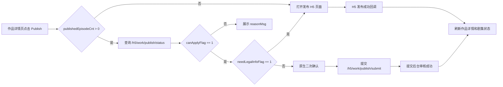
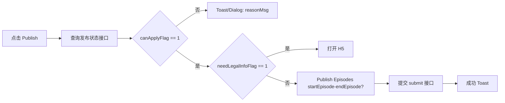

# 作品发布流程说明

整理时间：2026-05-21  
确认补充：2026-06-01
来源：MasterGo 发布流程截图局部放大图  
范围：作品详情页点击 `Publish` 后的发布判断、H5 交互、原生发布审核提交逻辑。发布 H5 页面本身不由 Android 实现。
关联逻辑文档：[作品发布功能逻辑说明](work-publish-logic.md)

## 1. 流程总览

用户在作品详情页点击底部 `Publish` 后，先判断该作品是否为首次发布：

- 首次发布：进入发布 H5 页面，由 H5 完成协议确认、首批发布集数确认、个人资料填写和提交。首批发布最低门槛是前 15 集全部已合成，实际提交范围按第 1 集起连续已合成集动态计算。
- 非首次发布：Android 原生侧处理后续剧集发布，包括可发布集判断、顺序发布校验、驳回集提醒、二次确认和提交审核。
- 2026-06-01 确认：Android 后续发布通过发布状态接口 `/h5/work/publish/status` 获取 `canApplyFlag/reasonMsg/startEpisode/endEpisode/auditBatchId`，不再依赖本地已加载分页列表自行计算完整可发布范围。
- 2026-06-02 补充：进入发布状态接口前，Android 需要先看作品是否已有首批发行成功记录。以 `publishedEpisodeCnt > 0` 作为“首次发行已成功”的判断；若 `publishedEpisodeCnt` 为空或为 `0`，即使用户之前已填写过法定姓名/邮箱但首批审核失败，也仍按首次发行未成功处理，直接打开 H5，不走原生后续发布。



### 1.1 已确认接口

#### 查询作品发行状态

```text
POST /h5/work/publish/status
```

请求体：

| 字段 | 类型 | 必填 | 说明 |
| --- | --- | --- | --- |
| `workId` | long | 是 | 作品 ID |

返回 `data`：

| 字段 | 类型 | 说明 |
| --- | --- | --- |
| `workId` | long | 作品 ID |
| `auditBatchId` | long | 正在审核中的批次号；存在时后续提交到指定批次 |
| `needLegalInfoFlag` | int | 是否需要提交法定姓名/邮箱，`0=否`，`1=是` |
| `startEpisode` | int | 当前可提交剧集区间起始集数，包含 |
| `endEpisode` | int | 当前可提交剧集区间结束集数，包含 |
| `canApplyFlag` | int | 是否可以继续提交申请，`0=否`，`1=是` |
| `reasonMsg` | string | `canApplyFlag=0` 时给前端展示的业务提示文案 |

Android 行为：

- 请求 `/h5/work/publish/status` 前，先用 `publishedEpisodeCnt > 0` 判断首批是否已经发行成功；未成功时直接打开 H5。首次审核失败、已填资料但未产生已发布剧集，也仍走 H5。
- `canApplyFlag=0`：不继续发布，直接展示 `reasonMsg`。默认用 Toast；如果文案较长或后端返回多行提示，可用通用弹窗展示。
- `needLegalInfoFlag=1`：打开 H5。该字段仍作为接口侧兜底判断，但不能替代 `publishedEpisodeCnt` 对首批是否成功的判断。
- `needLegalInfoFlag=0` 且 `canApplyFlag=1`：走 Android 原生后续发布确认和提交。

#### 提交作品剧集集中审核

```text
POST /h5/work/publish/submit
```

请求体：

| 字段 | 类型 | 必填 | 说明 |
| --- | --- | --- | --- |
| `workId` | long | 是 | 作品 ID |
| `auditBatchId` | long | 否 | 审核批次 ID；为空表示新建批次，不为空表示提交到指定批次 |
| `startEpisode` | int | 是 | 提交审核起始集数，包含 |
| `endEpisode` | int | 是 | 提交审核结束集数，包含 |
| `legalName` | string | 否 | 法定姓名，仅首次提交时由 H5 传，Android 后续发布不传 |
| `emailAddress` | string | 否 | 邮箱，仅首次提交时由 H5 传，Android 后续发布不传 |

返回体沿用项目 `ApiResponse`：`code/msg/data`。

## 2. 首次发布流程，H5 负责

首次发布指该作品第一次进入发布流程。Android 点击 `Publish` 后打开发布 H5 页面，H5 内部继续处理：

1. 用户在 H5 页面点击 `Publish`。
2. H5 判断是否已完成第 1-15 集。
3. 如果未完成，弹出未完成提示。
4. 如果已完成，判断用户是否勾选发布协议。
5. 如果未勾选协议，弹出默认同意发布协议的确认弹窗。
6. 协议确认后，弹出 `Publish Episodes 1-N?` 二次确认弹窗，`N` 按本次实际连续可提交集数动态展示。
7. 用户确认后，弹出 `Personal Info` 个人资料弹窗。
8. 用户填写 `Legal Name` 和 `Email Address` 后点击 `Submit`。
9. 提交成功后，H5 展示成功 toast，并通知 Android 刷新作品状态。

### 2.1 未完成 1-15 集

触发条件：H5 判断作品未完成第 1-15 集。

弹窗文案：

```text
Please complete episodes 1-15 before publishing.

OK
```

### 2.2 未勾选发布协议

触发条件：已完成 1-15 集，但用户未勾选发布协议。

弹窗文案：

```text
Publishing this drama means you agree to the Distribution Service Agreement.
Do you want to continue?

Cancel / Publish
```

用户点击 `Publish` 后，视为同意协议并继续发布确认流程。

### 2.3 首次发布二次确认

触发条件：已完成前 15 集，且协议确认完成。

弹窗文案：

```text
Publish Episodes 1-N?

These episodes will be submitted for review and made available to viewers once approved.
This action cannot be undone.

Cancel / Publish
```

### 2.4 个人资料填写

触发条件：用户确认发布首批连续可提交剧集。

弹窗文案和字段：

```text
Personal Info

Required to process your publishing application

We'll review your submission within 3-7 business days and notify you by email.

Legal Name*
Your full legal name

Email Address*
email@example.com

Submit

By submitting, you acknowledge our Privacy Policy.
```

提交成功 toast：

```text
You're all set!

Your application has been submitted.
```

## 3. 非首次发布流程，Android 原生负责

非首次发布指该作品已经发布过首批剧集，且 `/h5/work/publish/status` 返回 `needLegalInfoFlag=0` 的场景。后续再次点击 `Publish` 时走 Android 原生逻辑。



### 3.1 没有可发布剧集

判断条件：发布状态接口返回 `canApplyFlag=0`，且 `reasonMsg` 为无可发布剧集提示。

toast 文案：

```text
No episodes available to publish!
```

### 3.2 不满足顺序发布

判断条件：发布状态接口返回 `canApplyFlag=0`，且 `reasonMsg` 为不可跳集发布提示。

toast 文案：

```text
Episodes must be published in order.
You cannot skip episodes.
```

### 3.3 正常后续发布确认

判断条件：

- 发布状态接口返回 `canApplyFlag=1`。
- 发布状态接口返回 `needLegalInfoFlag=0`。
- `startEpisode`、`endEpisode` 有有效值。
- 本次发布范围内没有曾经被拒审的集。

弹窗文案示例：

```text
Publish Episodes 17-20?

These episodes will be submitted for review and made available to viewers once approved.
This action cannot be undone.

Cancel / Publish
```

其中 `17-20` 根据接口返回的 `startEpisode`、`endEpisode` 动态生成。

### 3.4 包含曾经被拒审的剧集

判断条件：

- 发布状态接口返回 `canApplyFlag=1`。
- 发布状态接口返回 `needLegalInfoFlag=0`。
- `startEpisode`、`endEpisode` 有有效值。
- 本次发布范围内包含曾经被拒审的集。

弹窗文案示例：

```text
Publish Episodes 17-20?

This submission contains rejected episodes.
Please ensure they are revised based on the feedback before resubmitting.

Cancel / Publish
```

用户点击 `Publish` 后，提交后台审核。

### 3.5 后续发布提交成功

提交成功后 toast：

```text
You're all set!

Your application has been submitted.
```

成功后刷新作品详情和剧集列表状态。

## 4. Android 与 H5 交互边界

Android 不实现发布 H5 页面。已确认：Android 先通过 `publishedEpisodeCnt > 0` 判断首批是否已经发行成功；首批未成功时进入 H5。首批已成功后，再通过发布状态接口判断是否走原生后续发布或 H5 兜底。

Android 侧需要负责：

1. 在作品详情页点击 `Publish` 后，先判断 `publishedEpisodeCnt > 0`；为空或为 `0` 时直接打开发布 H5 页面。
2. 首批已发行成功后，再请求 `/h5/work/publish/status`；`needLegalInfoFlag=1` 时打开发布 H5 页面作为接口侧兜底。
3. 打开 H5 时传入 H5 所需的上下文参数，例如作品 ID、登录 token、语言、客户端类型等。
4. 接收 H5 发布结果通知。
5. H5 发布成功后刷新作品详情、剧集列表和发布状态。
6. 首批已发行成功、`needLegalInfoFlag=0` 且 `canApplyFlag=1` 时走原生逻辑，不进入 H5。
7. 原生提交审核成功后刷新作品详情、剧集列表和发布状态，并通知我的创作列表刷新。

H5 侧需要负责：

1. 首次发布页面 UI 和交互。
2. 判断或通过接口获取前 15 集是否已完成。
3. 协议勾选与默认同意确认。
4. 首批连续可提交剧集发布二次确认。
5. 个人资料填写、校验和提交。
6. 发布成功后的页面行为与 Android 通知方式。

## 5. 建议的状态与字段

具体字段以接口返回为准，Android 侧至少需要能判断以下信息：

| 字段含义 | 用途 |
| --- | --- |
| 作品 ID | 打开 H5、提交后续发布、刷新详情 |
| `publishedEpisodeCnt` | 判断首批是否已经发行成功；为 0 时直接打开 H5 |
| `needLegalInfoFlag` | 首批已成功后的 H5 兜底判断 |
| `canApplyFlag` | 决定是否允许继续发布申请 |
| `reasonMsg` | 不允许发布时直接展示的业务提示 |
| `auditBatchId` | 原生提交时传回后台，提交到指定审核批次 |
| `startEpisode/endEpisode` | 原生二次确认标题和提交范围 |
| `showPublishButton` | 控制底部 Publish 按钮隐藏或展示 |
| `publishedEpisodeCnt/totalEpisodeCnt` | 判断全部剧集已完结且全部发行时按钮置灰 |

## 6. 实现检查点

- 点击 `Publish` 后必须先判断 `publishedEpisodeCnt > 0`；首批未发行成功时直接进入 H5。
- 首批已成功后再请求 `/h5/work/publish/status`；`needLegalInfoFlag=1` 只打开 H5，不在 Android 原生侧实现 H5 页面内的弹窗、表单和协议逻辑。
- H5 发布成功后，Android 必须刷新作品详情和剧集状态，避免页面仍显示旧状态。
- 非首次发布时，使用 `canApplyFlag/reasonMsg/startEpisode/endEpisode` 处理是否允许发布和发布范围。
- 后续发布二次确认弹窗标题中的剧集范围必须按 `startEpisode/endEpisode` 动态生成。
- `canApplyFlag=0` 时必须展示后端 `reasonMsg`，不要自行拼接本地原因。
- 所有成功提交审核的分支统一展示 `You're all set! Your application has been submitted.`。

## 7. 已确认项与待确认项

### 7.1 已确认项

- Android 通过 `publishedEpisodeCnt > 0` 判断首批是否已经发行成功；首批未成功直接走 H5。
- 首次发布流程全部在 H5 内完成，Android 不实现 H5 内的协议、资料填写、发布确认和提交逻辑。
- 后续发布使用 `/h5/work/publish/status` 和 `/h5/work/publish/submit`。
- `needLegalInfoFlag=1` 代表仍需 H5 法定姓名/邮箱流程或接口侧要求 H5 兜底；首次发布失败回来也仍算首次。
- `/h5/work/publish/submit` 一次提交连续剧集范围：`startEpisode` 到 `endEpisode`。
- `legalName`、`emailAddress` 只由 H5 首次提交传，Android 后续提交不传。
- `showPublishButton` 实际有 3 种前端表现：`0=隐藏`，`1=展示可点击`，`1 且全部剧集已完结并全部发行=展示但置灰`。
- 后端会把拒审原因拼到 `rejectReason`，Android 不需要本地按集拼接。

### 7.2 待确认项

- H5 提交成功后是自动关闭页面，还是只通知 Android 并由用户手动返回。
- `canApplyFlag=0` 的 `reasonMsg` 默认 Toast 展示；如果后续出现长文案或多行文案，再切换为通用弹窗。
