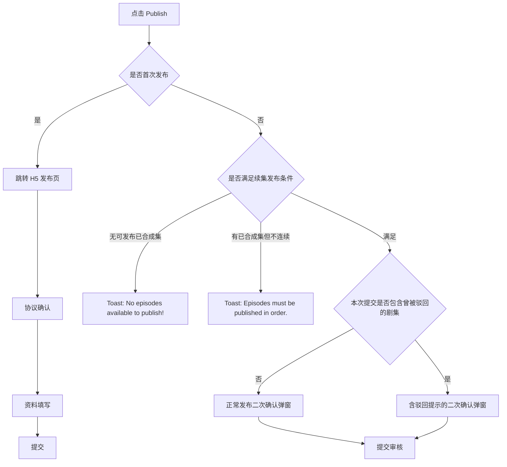

# 作品发布功能逻辑说明

整理时间：2026-05-21  
来源：发布功能逻辑截图与作品详情页状态截图  
关联流程文档：[作品发布流程说明](work-publish-flow.md)

本文用于补充作品发布流程中的状态体系、发布入口判断、可发布集数计算、边界条件和弹窗/toast 文案。发布 H5 页面本身不由 Android 实现；Android 负责判断是否首次发布、打开 H5 容器、接收 H5 结果并刷新状态，首次发布进入 H5 后的流程全部由 H5 完成。

## 1. 状态体系

### 1.1 剧集状态定义

| 状态 | 中文含义 | 说明 |
| --- | --- | --- |
| `Draft` | 草稿 | 未合成的剧集 |
| `Unpublished` | 待发布 | 已合成，未提交发布 |
| `In Review` | 审核中 | 已提交，审核进行中 |
| `Live` | 已发布 | 审核通过，已上线 |

注意：剧集层面不展示 `Review Failed` 角标。审核失败时，只在作品层面展示 `Review Failed`；对应失败剧集状态回退为 `Unpublished`，允许用户重新提交。

### 1.2 作品状态定义

作品状态包括：

- `Review Failed`：审核失败。
- `Draft`：草稿。
- `Unpublished`：待发布。
- `In Review`：审核中。
- `Published`：已发布。

作品状态有两类计算方式。

#### 1.2.1 审核失败状态

当任意提交审核中的剧集被审核失败时：

1. 后台直接将作品状态置为 `Review Failed`，该状态不参与普通优先级计算。
2. 对应失败剧集状态变更为 `Unpublished`，允许重新提交。
3. 用户可点击作品层面的 `Review Failed` 角标，查看后台返回的拒审理由。
4. 当有任意一集状态发生变更时，`Review Failed` 自动消失，作品状态重新按普通优先级计算。

#### 1.2.2 普通状态优先级

非审核失败状态下，作品状态基于该作品所有剧集状态计算，取优先级最高的状态展示。

优先级从高到低：

```text
Unpublished > Draft > In Review > Live
```

| 优先级 | 剧集状态条件 | 作品状态展示 |
| --- | --- | --- |
| 1（最高） | 含 `Unpublished` 集 | `Unpublished` |
| 2 | 含 `Draft` 集 | `Draft` |
| 3 | 含 `In Review` 集 | `In Review` |
| 4（最低） | 全部为 `Live` | `Published` |

所有剧集均为 `Live` 时，作品状态展示 `Published`。任意一集状态变更时，作品状态需要实时重新计算。

### 1.3 作品状态展示样式

| 场景 | 展示文案示例 |
| --- | --- |
| 审核失败 | `Review Failed` |
| 待发布 | `Unpublished` |
| 草稿 | `Draft` |
| 审核中 | `In Review` |
| 部分集已发布 | `Published · 15 Eps` |
| 全部集已发布 | `Published · All Eps` |

当作品为 `Review Failed` 时，角标可点击，点击后展示被退回理由弹窗。

## 2. 发布入口与路径

点击作品详情页底部 `Publish` 后，先判断是否为该作品首次发布。



路径规则：

- 首次发布：Android 判断为首次发布后跳转 H5 发布页，后续协议确认、资料填写与提交全部由 H5 完成。
- 续集发布：Android 原生侧判断是否满足续集发布条件。
- 无可发布的已合成集：直接 toast。
- 有已合成集但不满足连续发布条件：直接 toast。
- 满足续集发布条件：继续判断本次提交范围内是否包含曾被驳回的剧集，决定展示普通二次确认还是驳回提醒二次确认。

## 3. 发布条件与集数计算

### 3.1 首次发布可发布集数规则

首次发布必须满足：

- 前 15 集全部已合成。

满足后，可发布集数不是固定 15 集，而是从第 1 集开始连续已合成的全部集数。

示例：

- 第 1-15 集已合成，第 16 集未合成：首次提交范围为 `1-15`。
- 第 1-16 集已合成，第 17 集未合成：首次提交范围为 `1-16`，确认弹窗标题展示 `Publish Episodes 1-16?`。

### 3.2 续集发布可发布集数规则

续集发布时，从已发布/审核中剧集之后继续计算可提交的连续剧集范围。

规则：

1. 只从已合成且未发布的剧集中取可发布范围。
2. 取与已发布/审核中集数连续的部分。
3. 从已发布/审核中的最大集数 + 1 开始计算，连续已合成则可发布，遇到未合成或断集时截止。
4. 审核中剧集视为连续性占位，计算连续性时纳入；但对外展示的已发布集数仍以 `Live` 剧集为准。
5. 曾被驳回的剧集状态回退为 `Unpublished`。如果它处于本次连续可发布范围内，需要计入本次发布，并在提交前触发驳回提醒二次确认弹窗。

示例：

```text
已发布第 1-15 集
第 16 集审核中，占位
第 17、18 集已合成
第 19 集未合成
```

此时可提交第 17、18 集。若第 17 集曾经被驳回过，则触发含驳回提示的二次确认弹窗。

## 4. 边界条件

### 4.1 审核中剧集审核失败

当审核中剧集审核失败：

1. 作品状态更新为 `Review Failed`。
2. 被退回的剧集角标变更为 `Unpublished`，允许重新提交。
3. 作品层面的 `Review Failed` 角标可点击。
4. 点击后展示后台返回的拒审理由弹窗。

拒审理由弹窗按剧集或连续剧集范围展示，例如：

```text
EP.1
Episode publication failed. Please verify your content and retry.

EP.12
Episode publication failed. Please verify your content and retry.

EP.19
Episode publication failed. Please verify your content and retry.

EP.20 - EP.25
Episode publication failed. Please verify your content and retry.
```

### 4.2 重新提交审核失败剧集

重新提交审核失败剧集后：

1. 作品状态重新按普通优先级计算。
2. `Review Failed` 角标消失。
3. 被重新提交的剧集进入 `In Review` 或接口返回的目标状态。

### 4.3 所有剧集均已发布

当所有剧集均为 `Live`：

1. 作品角标展示 `Published · All Eps`。
2. 底部 `Publish` 按钮置灰，不允许再次提交。
3. 若仍点击或触发发布入口，应按无可发布内容处理。

### 4.4 续集无可发布剧集

续集发布时，如果没有未发布且已合成的剧集，点击 `Publish` 后展示 toast：

```text
No episodes available to publish!
```

## 5. 弹窗与 Toast 文案

### 5.1 首次发布

#### 5.1.1 未完成前 15 集提示弹窗

触发条件：首次发布，前 15 集未全部合成，点击 `Publish`。

形式：弹窗，单按钮。

正文：

```text
Please complete episodes 1-15 before publishing.
```

操作：

```text
OK -> 关闭弹窗
```

#### 5.1.2 发布协议确认弹窗

触发条件：首次发布，前 15 集已全部合成，且用户未勾选协议选择框。

形式：弹窗。

正文：

```text
Publishing this drama means you agree to the Distribution Service Agreement. Do you want to continue?
```

操作：

```text
Cancel / Publish
点击 Publish -> 进入集数二次确认弹窗
```

#### 5.1.3 首次发布集数确认弹窗

触发条件：首次发布，前 15 集已全部合成，且用户已完成协议确认。

形式：弹窗。

标题：

```text
Publish Episodes 1-16?
```

标题中的集数范围按本次实际提交集数动态展示，不固定为 `1-16`。

正文：

```text
These episodes will be submitted for review and made available to viewers once approved. This action cannot be undone.
```

操作：

```text
Cancel / Publish
点击 Publish -> 提交审核 -> 触发发布成功 toast
```

### 5.2 续集发布

#### 5.2.1 无可发布集 Toast

触发条件：续集发布，无未发布且已合成的剧集，点击 `Publish`。

形式：toast。

文案：

```text
No episodes available to publish!
```

#### 5.2.2 不可跳集发布 Toast

触发条件：续集发布，有已合成集但不满足连续发布条件，点击 `Publish`。

形式：toast。

文案：

```text
Episodes must be published in order. You cannot skip episodes.
```

#### 5.2.3 含驳回剧集二次确认弹窗

触发条件：续集发布，满足连续发布条件，但本次提交范围内包含曾被驳回的剧集。

形式：弹窗。

标题示例：

```text
Publish Episodes 17-20?
```

正文：

```text
This submission contains rejected episodes. Please ensure they are revised based on the feedback before resubmitting.
```

操作：

```text
Cancel / Publish
点击 Publish -> 提交审核 -> 触发发布成功 toast
```

#### 5.2.4 正常续集发布确认弹窗

触发条件：续集发布，满足连续发布条件，且本次提交范围内没有曾被驳回的剧集。

形式：弹窗。

标题示例：

```text
Publish Episodes 17-20?
```

正文：

```text
These episodes will be submitted for review and made available to viewers once approved. This action cannot be undone.
```

操作：

```text
Cancel / Publish
点击 Publish -> 提交审核 -> 触发发布成功 toast
```

### 5.3 发布成功 Toast

触发条件：首次发布或续集发布，用户在确认弹窗中点击 `Publish` 且提交成功。

形式：深色背景 toast。

标题：

```text
You're all set!
```

正文：

```text
Your application has been submitted.
```

说明：所有弹窗标题中的集数范围均为动态填充，需要根据本次实际提交集数展示。

## 6. 与发布流程文档的关系

[作品发布流程说明](work-publish-flow.md) 描述完整业务路径和 Android/H5 职责边界；本文补充状态计算、可发布集数计算和文案细节。

实现时建议先按本文计算出：

1. 当前作品状态。
2. 是否首次发布。
3. 本次可提交剧集范围。
4. 本次提交范围内是否包含曾被驳回剧集。

再按 [作品发布流程说明](work-publish-flow.md) 选择 H5 或原生发布路径。
